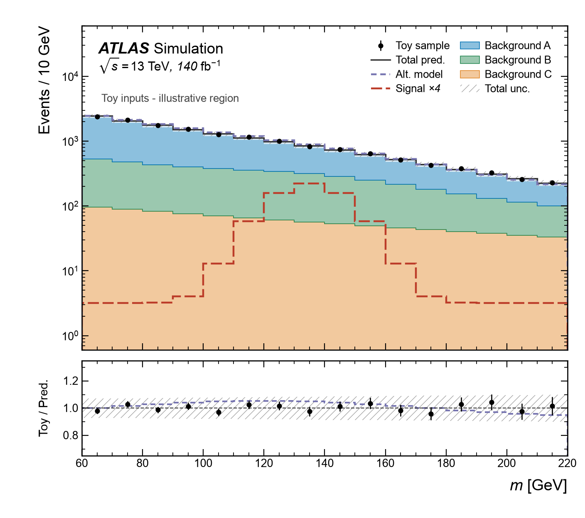
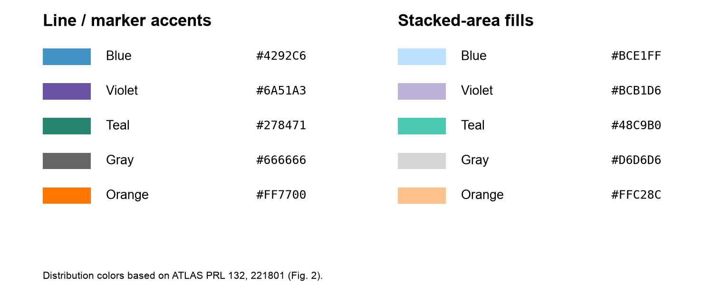
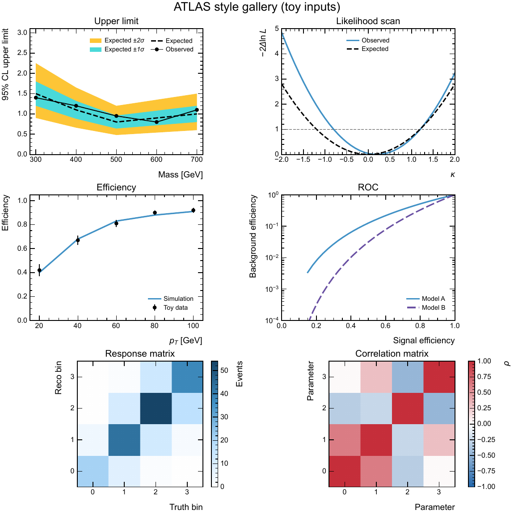

# ATLAS publication plotting style

[简体中文](README.md) · **English**

Publication-style defaults for Matplotlib and ROOT, with editable examples for both. The package provides typography, ticks, margins, legends, labels, colors, line styles, markers, uncertainty bands and export settings. Analysis scripts handle data, binning, normalization, uncertainties and fits.

Matplotlib builds on the ATLAS style in `mplhep`. ROOT uses standalone C++ headers that also work in PyROOT. Both follow the same visual conventions, with backend-specific font rendering and size units.





## Installation

The pip distribution is `analysis-atlas-style`, version `0.2.0`. The Python import and C++ namespace are both `ana_atlas_style`. With Python 3.11 or later, run this from the directory containing `pyproject.toml`.

```bash
python -m pip install -e '.[mpl]'
```

For C++ ROOT or PyROOT only, use `python -m pip install -e .` and activate an existing ROOT environment. Importing `ana_atlas_style` leaves both plotting backends unloaded and global style settings untouched.

### Use from another analysis project

Install the package once in the Python or conda environment used to run your analysis. Use an absolute path for an editable install, or install from the private GitHub repository with your SSH credentials.

```bash
python -m pip install -e '/absolute/path/to/style-repository[mpl]'
python -m pip install 'analysis-atlas-style[mpl] @ git+ssh://git@github.com/chanfeee/analysis-atlas-style.git'
```

Choose one command. Omit `[mpl]` for ROOT-only use. If the source is in a `plotting/` subdirectory of the current project, use `python -m pip install -e './plotting[mpl]'`.

### Minimal Matplotlib example

```python
import matplotlib.pyplot as plt
from ana_atlas_style import use_style, artist_style, atlas_label

use_style("mpl")
fig, ax = plt.subplots()
ax.stairs(
    [12, 25, 18], [0, 10, 20, 30],
    label="Toy prediction",
    **artist_style("prediction", linewidth=2.5),
)
ax.set(xlabel=r"$m$ [GeV]", ylabel="Events / 10 GeV", ylim=(0, 40))
atlas_label(ax, text="", data=False, com=13)
ax.legend()

fig.savefig("mpl_example.pdf")
plt.close(fig)
```

The default font is Arial. To use an installed compatible TrueType font, pass `use_style("mpl", font="Liberation Sans")`.

### Minimal PyROOT example

Run this where `import ROOT` works and Ghostscript (`gs`) is on PATH. `use_style("root")` loads the bundled C++ headers and returns a native `TStyle*`.

```python
import ROOT
from ana_atlas_style import use_style

ROOT.gROOT.SetBatch(True)
use_style("root")

canvas = ROOT.TCanvas("canvas", "", 800, 600)
hist = ROOT.TH1D("hist", ";m [GeV];Events / 10 GeV", 3, 0, 30)
hist.SetDirectory(0)

for i, value in enumerate([12, 25, 18], start=1):
    hist.SetBinContent(i, value)

ROOT.ana_atlas_style.Prediction(hist)
hist.SetLineWidth(3)
hist.SetMinimum(0)
hist.SetMaximum(40)
hist.Draw("HIST")
ROOT.ana_atlas_style.AtlasLabel(0.20, 0.89, "Simulation")

canvas.Print("root_example.pdf", "EmbedFonts")
```

Apply the global style before creating objects. Apply optional presets, then customize individual objects before exporting.

### Upgrading from 0.1.0

Reinstall the package and replace Python imports of `plotting` with `ana_atlas_style`. In C++, use `ana_atlas_style::use_style()`, `ana_atlas_style::AtlasLabel()` and `ana_atlas_style::Prediction(hist)`. Color functions live in `ana_atlas_style::colors`. In PyROOT, use `ROOT.ana_atlas_style`.

## Public API

| Python API | Purpose |
| --- | --- |
| `use_style("mpl", font="Arial", rc=None)` | Apply global Matplotlib defaults |
| `atlas_style(font="Arial", rc=None)` | Apply defaults temporarily and restore the surrounding rc settings on exit |
| `artist_style(role, index=0, **overrides)` | Return fresh native drawing keyword arguments |
| `matrix_style(kind="density", **overrides)` | Return color scale arguments for two-dimensional plots |
| `atlas_label(ax, text=..., data=..., com=..., lumi=None, **kwargs)` | Add an ATLAS label with optional dataset information |
| `use_style("root")` | Load the bundled headers, apply the ROOT defaults and return a `TStyle*` |
| `root_include_dir()` | Return the C++ header directory as a `Path` |
| `COLORS`, `FILL_COLORS`, `SERIES_COLORS`, `SERIES_FILL_COLORS` | Named role colors and general-purpose series colors |
| `BACKGROUND_COLORS`, `BACKGROUND_FILL_COLORS` | MC background outlines and fills |

For ATLAS labels, `com` is in TeV and `lumi` in fb⁻¹. Use `data=False` for simulation. The default label location is `loc=4`. Extra keyword arguments are passed to `mplhep.atlas.label`.

Python examples use `use_style` for both backends. The existing `use_atlas_style()`, `use_root_style()` and C++ `SetAtlasStyle()` entry points remain available.

| Operation | Matplotlib | PyROOT | C++ ROOT |
| --- | --- | --- | --- |
| Initialize | `use_style("mpl")` | `use_style("root")` | `ana_atlas_style::use_style()` |
| Pick a background color | `artist_style("background", index=i)` | `ROOT.ana_atlas_style.Background(hist, i)` | `ana_atlas_style::Background(hist, i)` |
| Add an ATLAS label | `atlas_label(ax, ...)` | `ROOT.ana_atlas_style.AtlasLabel(x, y, ...)` | `ana_atlas_style::AtlasLabel(x, y, ...)` |

Matplotlib presets return native keyword arguments. ROOT presets set attributes on native objects. Both allow manual overrides after applying defaults.

## C++ ROOT and distribution

Find the bundled header directory for `ROOT_INCLUDE_PATH` or a compiler's `-I` option.

```bash
python -m ana_atlas_style --root-include
atlas-style --root-include
atlas-style --version
```

Add that directory to the include path, then include `AtlasStyle.h`. You can also copy all three headers together into a standalone C++ project.

```cpp
#include "AtlasStyle.h"

// In your macro, before creating the canvas and plot objects:
auto* style = ana_atlas_style::use_style();
style->SetLegendTextSize(0.035);

// After creating the histogram:
ana_atlas_style::Signal(signal);
signal.SetLineStyle(1);
signal.SetLineWidth(4);
```

After drawing, call `ana_atlas_style::AtlasLabel(0.20, 0.89, "Simulation")` with pad-normalized coordinates. Object presets set attributes on the supplied native object and return it by reference. ROOT's `ForceStyle` is left to the caller.

Build a wheel with `python -m pip wheel --no-deps . --wheel-dir dist`. The wheel contains the runtime code, both READMEs and the headers. Example scripts, toy inputs, tests and previews are in the source checkout.

## Defaults and manual overrides

The package applies the ATLAS base style, then its own defaults, then caller overrides. Saving a figure preserves the current artist properties.

| Element | Default | Override |
| --- | --- | --- |
| Canvas and axes | White background, inward ticks on all four sides, minor ticks, no grid. Base size is 8 × 6 inches or 800 × 600 in ROOT | Native rc settings, `Figure` / `Axes`, `TCanvas` / `TPad` |
| Fonts and legends | Arial in Matplotlib, Helvetica in ROOT, black text and frameless legends | rc settings, label kwargs, native setters |
| Data and prediction | Filled black circles with uncapped errors and a dark gray solid prediction line | `data`, `prediction` |
| Signal and alternative model | Long violet dashes and short orange dashes | `signal`, `alternative` |
| Backgrounds | Eight fixed colors with matching fills and outlines | `background` with an `index` from 0 to 7 |
| Uncertainty | Gray hatching, with an optional translucent white underlay | `uncertainty` or ROOT's `Uncertainty` and `UncertaintyShade` |
| Reference and annotation | Dark gray dashed line and dark gray annotation text | `reference`, `annotation` |
| Export | Vector PDF with embedded fonts. Matplotlib raster exports default to 300 dpi | Native `savefig` / `Print` arguments |

```python
from ana_atlas_style import artist_style, atlas_style

with atlas_style(rc={"axes.labelsize": 18}):
    fig, ax = plt.subplots()
    signal_line = ax.stairs(
        signal, edges, **artist_style("signal", color="#4292C6", linestyle="-")
    )
    signal_line.set_linewidth(3)
    fig.savefig("figure.pdf")
```

Use `fill=True` for a filled Matplotlib stair plot. Baselines, stacking order, axes, units and uncertainties come from the analysis. Matplotlib's plain curves use the general-purpose color cycle. For ROOT overlays, select an index explicitly.

## Color palettes

The violet signal and orange alternative-model accents draw on two curves from the ATLAS Higgsino search. INSPIRE recorded 45 citations on 2026-11-09. The paper uses Run 2 data. [PRL 132, 221801 (2024), Fig. 2](https://arxiv.org/pdf/2401.14046#page=7) · [INSPIRE](https://inspirehep.net/literature/2751400)

The MC stack uses the five exact reference colors, plus sage, muted gold and lilac.

| Index | MC background | Fill | Outline |
| --- | --- | --- | --- |
| 0 | Navy | `#33395B` | `#33395B` |
| 1 | Slate blue | `#5D74A2` | `#5D74A2` |
| 2 | Pale blue | `#C4D8F2` | `#C4D8F2` |
| 3 | Wine red | `#8E2D30` | `#8E2D30` |
| 4 | Sage | `#82AD92` | `#82AD92` |
| 5 | Muted gold | `#CFAB66` | `#CFAB66` |
| 6 | Lilac | `#AB99C6` | `#AB99C6` |
| 7 | Warm ivory | `#F2E8E3` | `#F2E8E3` |

The eight-layer examples share the binning, backgrounds, signal, pseudo-data and relative uncertainty. The ratio points have errors of `sqrt(pseudo_data) / prediction`, and the prediction uncertainty is drawn as a separate band around 1. [Shared toy inputs](examples/stack8_inputs.dat)

```bash
python -m ana_atlas_style.examples.stack8_mpl
root -l -b -q examples/stack8_root.C
```

Run both commands from an editable checkout. ROOT needs Ghostscript to embed fonts. Outputs are under `examples/output/`.

| Backend | Example figures | Source |
| --- | --- | --- |
| Matplotlib | [PNG](docs/stack8_mpl.png) · [Vector PDF](docs/stack8_mpl.pdf) | [Python](examples/stack8_mpl.py) |
| ROOT | [PNG](docs/stack8_root.png) · [Vector PDF](docs/stack8_root.pdf) | [C++ macro](examples/stack8_root.C) |

Use `artist_style("background", index=i)` or `ana_atlas_style::Background(hist, i)` for both fill and outline. Use `BACKGROUND_COLORS[i]`, `BACKGROUND_FILL_COLORS[i]` or the C++ `colors::Background(i)` and `colors::BackgroundFill(i)` for direct access. Keep a stable process-to-index mapping in each analysis.

Background presets accept indexes 0–7. Outside that range, Matplotlib raises an index error. ROOT reports an error, preserves the object's current style, and returns `-1` from the color lookup. Set additional colors in the analysis script. Pass `facecolor` and `edgecolor` to `ax.stairs(..., fill=True)` in Matplotlib, or use ROOT's `SetFillColor`, `SetLineColor` and `SetFillStyle(1001)` with your own color.

| Role | Python key | C++ function in `ana_atlas_style::colors` | Accent | Optional fill |
| --- | --- | --- | --- | --- |
| Data | `data` | `Data()` | `#000000` | — |
| Nominal or total prediction | `prediction` | `Prediction()` | `#333333` | `#D6D6D6` |
| Signal | `signal` | `Signal()` | `#6A51A3` | `#BCB1D6` |
| First background | `background` | `Background()` | `#33395B` | `#33395B` |
| Alternative model | `alternative` | `Alternative()` | `#FF7700` | `#FFC28C` |
| Uncertainty | `uncertainty` | `Uncertainty()` | `#666666` | — |
| Reference line | `reference` | `Reference()` | `#404040` | — |
| Annotation | `annotation` | `Annotation()` | `#444444` | — |

## Common plot types

| Plot | Default convention | Matplotlib / ROOT |
| --- | --- | --- |
| Data vs prediction and MC stacks | Black data, dark gray total, distinct background fills and hatched uncertainty. The two-panel example uses a shared x-axis and an approximately 3:1 height ratio | `data`, `prediction`, `background`, `uncertainty` / `Data`, `Prediction`, `Background`, `Uncertainty` |
| Cutflows and yields by category | Colored background bars and black data markers. Use a log y-axis for yields spanning orders of magnitude | `background`, `data` / `Background`, `Data` |
| Shape overlays, profiles and systematic variations | Unfilled curves distinguished by color and line pattern | `series` / `Series` |
| Ratios, residuals and pulls | Reuse the main-panel colors. The reference is 1 for ratios and 0 for residuals or pulls | `reference` / `Reference` |
| Efficiency and ROC | Black efficiency points with errors and colored simulation curves. ROC shows signal efficiency on x and background efficiency on y | `data`, `series` / `Data`, `Series` |
| Upper limits | Black observed markers and solid line, dashed black expected line. Draw the yellow ±2σ band before the cyan ±1σ band | `expected`, `expected_1sigma`, `expected_2sigma` / `Expected`, `Expected1Sigma`, `Expected2Sigma` |
| Likelihood or significance scans and confidence contours | Indexed curve colors and line styles, gray threshold lines and labeled contour levels | `series`, `reference` / `Series`, `Reference` |
| 2D densities, response and confusion matrices | Sequential white-to-dark-blue scale with a labeled colorbar | `matrix_style("density")` / `Density(hist)` |
| Correlations and signed deviations | Diverging blue–white–red scale, with white at zero and default range [−1, 1] for correlations | `matrix_style("correlation")` / `Correlation(hist)` |

The cyan `#4AD9D9` and yellow `#FDC536` expected bands come from the ATLAS Higgs-pair combination. INSPIRE recorded 190 citations on 2026-11-09. [PRL 133, 101801 (2024), Fig. 2](https://arxiv.org/pdf/2406.09971#page=5) · [INSPIRE](https://inspirehep.net/literature/2798812)

For contours, pass the indexed series color, line style and width to `ax.contour`. In ROOT, `hist.SetContour(1, &level)` sets a single level, and `CONT LIST` makes the contour segments available as native graphs for styling with `ana_atlas_style::Series`. The analysis supplies the levels. [ROOT contour options](https://root.cern.ch/doc/v640/classTHistPainter.html)

Pass `matrix_style(...)` to Matplotlib's `imshow` or `pcolormesh`. An explicit `norm` supplies your own normalization. For ROOT, apply the preset and draw with `hist.Draw("COLZ")`. ROOT's continuous palette belongs to the current style. Export plots with different palettes separately, or select the palette when each pad is painted. Native axis limits can override the correlation range.

## Examples and export

From an editable source checkout, run the examples from the repository root.

```bash
python -m ana_atlas_style.examples.atlas_mpl
python -m ana_atlas_style.examples.showcase_mpl
python -m ana_atlas_style.examples.palette
python -m ana_atlas_style.examples.gallery_mpl
python -m ana_atlas_style.examples.gallery_root
root -l -b -q examples/atlas_root.C
root -l -b -q examples/showcase_root.C
```



The gallery outputs are under `examples/output/`. ROOT exports its response and correlation matrices separately so each uses its intended palette. [ROOT correlation matrix preview](docs/gallery_root_correlation.png)

The stacked examples share the fixed inputs in `examples/showcase_inputs.dat`. Their upper panels have a log y-axis and show a signal scaled by four. The lower panel shows the toy count divided by the nominal prediction, with a data error of `sqrt(toy_sample) / nominal` and a separate prediction uncertainty band centered at 1.

For an ATLAS publication label, use `ATLAS` and add status text explicitly where appropriate. The examples use simulated inputs. For a ROOT PNG preview, render the PDF using its CropBox.

```bash
gs -q -dSAFER -dBATCH -dNOPAUSE -dUseCropBox -sDEVICE=png16m -r150 -sOutputFile=examples/output/showcase_root.png examples/output/showcase_root.pdf
```

## References and verification

The distribution layout follows Fig. 1 of an ATLAS publication, including the white background, inward ticks, bold italic ATLAS label, frameless legend, black data markers and hatched uncertainty. [ATLAS JHEP 08 (2024) 182](https://arxiv.org/abs/2406.19701v2)

The style implementation uses publicly available ROOT parameters and the mplhep style interface. The full ATLAS PubCom guidance requires CERN access. [ATLAS public ROOT header](https://atlas-sw-doxygen.web.cern.ch/atlas-sw-doxygen/atlas_main--Doxygen/docs/html/da/d4a/Trigger_2TrigAnalysis_2TrigInDetAnalysisUser_2Analysis_2src_2AtlasStyle_8h.html) · [mplhep styling guide](https://scikit-hep.org/mplhep/1.1/guide_styling/) · [ATLAS PubCom guidance](https://twiki.cern.ch/twiki/bin/view/AtlasProtected/PubComPlotStyle)

After an editable install, run `python -m unittest discover -s tests -v`. The suite checks backend-free imports, header discovery, manual overrides, rc restoration and color parity. Backend-specific checks are skipped when their backend is unavailable. For the verified Matplotlib versions, install with `python -m pip install -c requirements.txt -e '.[mpl]'`.
