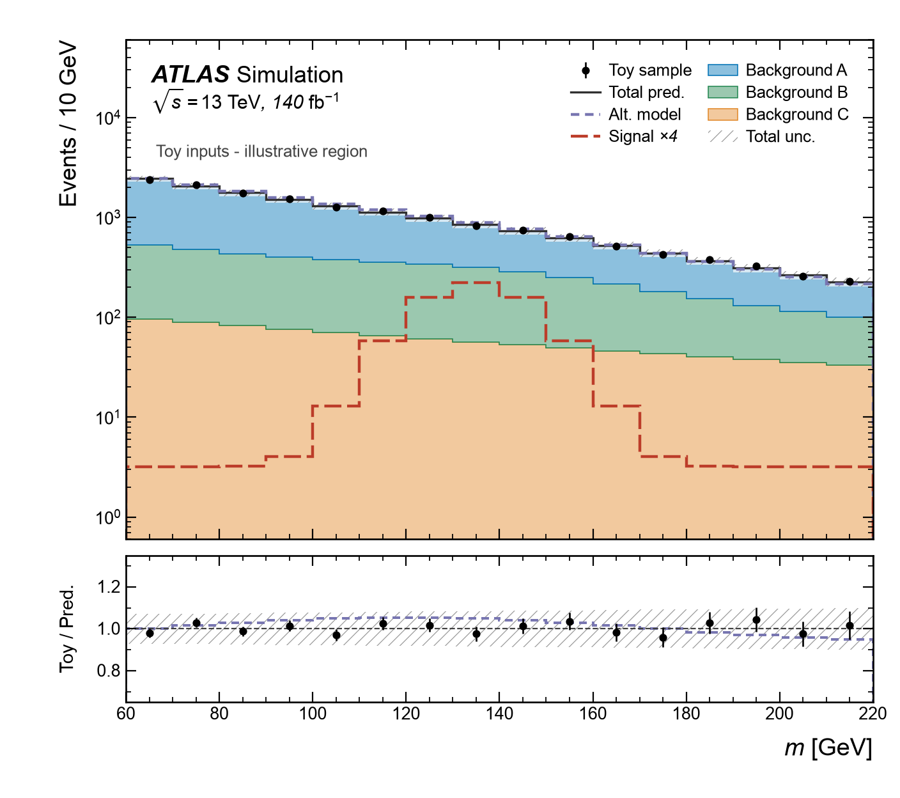
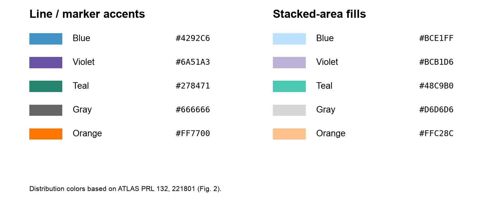
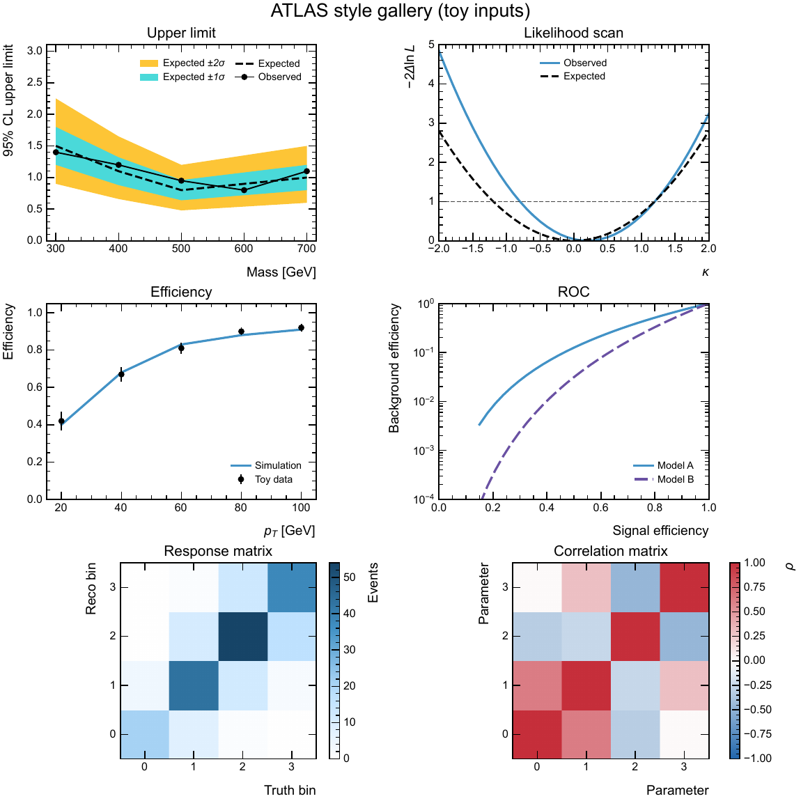

# ATLAS 发表绘图风格

**简体中文** · [English](README.en.md)

本目录提供 ATLAS 风格默认值、可选的对象样式预设和可编辑示例。范围是字体、字号、刻度、边距、图例、标注、颜色、线型、数据点、误差带和导出格式；数据读取、分箱、归一化、误差计算及拟合由各分析脚本负责。

Matplotlib 使用 `mplhep` 的 ATLAS 样式；ROOT 使用按公开 ATLAS 样式参数整理的独立头文件，可供 C++ 和 PyROOT 使用。两端遵循相同的 ATLAS 排版约定，字体渲染和尺寸单位存在后端差异，不保证逐像素相同。

综合样图使用固定 toy 数据，展示堆叠背景、信号、替代模型、误差带和比值面板：





## 安装与统一入口

这是独立可安装的 `analysis-atlas-style` 包，Python 导入名为 `ana_atlas_style`，当前版本 `0.2.0`。使用 Python 3.11+，克隆仓库后在包含 `pyproject.toml` 的仓库根目录执行：

```bash
python -m pip install -e '.[mpl]'
```

只使用 ROOT / PyROOT 时执行 `python -m pip install -e .`。ROOT 由现有环境提供，调用 `use_style("root")` 时才加载 PyROOT。导入 `ana_atlas_style` 本身不会加载后端或修改全局绘图设置。

如果本包位于另一个项目的 `plotting/` 子目录，在外层项目目录使用 `python -m pip install -e './plotting[mpl]'` 即可。源码示例、测试和构建命令以本包的仓库根目录为工作目录；下方跨项目安装命令可在任意目录执行。

### 跨项目安装

在每个分析项目使用的 Python / conda 环境中安装一次，之后即可从任意分析目录直接 `import ana_atlas_style`，无需复制风格文件或添加 `sys.path`。安装时使用的 `python` 应与运行分析脚本时一致。

本机可直接以绝对路径复用当前源码；编辑式安装会跟随该目录中的风格修改：

```bash
python -m pip install -e '/absolute/path/to/style-repository[mpl]'
```

若源码位于其他位置，将上述绝对路径替换为实际源码目录。其他机器也可直接从私有 GitHub 仓库安装，需要已有该仓库的 SSH 访问权限：

```bash
python -m pip install 'analysis-atlas-style[mpl] @ git+ssh://git@github.com/chanfeee/analysis-atlas-style.git'
```

两种方式任选其一。`[mpl]` 会安装 Matplotlib 相关依赖；只使用 ROOT / PyROOT 时可去掉 `[mpl]`，ROOT 环境仍由调用者提供。

### Matplotlib 最小示例

下面的代码可直接放进其他分析项目的 Python 脚本中运行，使用 toy 数据并输出 `mpl_example.pdf`：

```python
import matplotlib.pyplot as plt
from ana_atlas_style import use_style, artist_style, atlas_label

use_style("mpl")  # 在创建 Figure 前调用
fig, ax = plt.subplots()
ax.stairs(
    [12, 25, 18], [0, 10, 20, 30],  # toy 数据
    label="Toy prediction",
    **artist_style("prediction", linewidth=2.5),
)
ax.set(xlabel=r"$m$ [GeV]", ylabel="Events / 10 GeV", ylim=(0, 40))
atlas_label(ax, text="", data=False, com=13)  # 能量仅为示例
ax.legend()

fig.savefig("mpl_example.pdf")
plt.close(fig)
```

默认字体为 Arial；没有该字体时，可通过 `use_style("mpl", font="Liberation Sans")` 显式选择已安装的兼容 TrueType 字体。

### ROOT / PyROOT 最小示例

在能够 `import ROOT` 的 Python 环境中运行。`use_style("root")` 自动加载随包分发的 C++ 头文件，返回原生 `TStyle*`。下面使用相同的 toy 数据输出 `root_example.pdf`；`EmbedFonts` 导出选项需要 `gs`（Ghostscript）在 PATH 中：

```python
import ROOT
from ana_atlas_style import use_style

ROOT.gROOT.SetBatch(True)
use_style("root")  # 自动加载头文件，并在创建绘图对象前应用默认值

canvas = ROOT.TCanvas("canvas", "", 800, 600)
hist = ROOT.TH1D("hist", ";m [GeV];Events / 10 GeV", 3, 0, 30)
hist.SetDirectory(0)

for i, value in enumerate([12, 25, 18], start=1):
    hist.SetBinContent(i, value)

ROOT.ana_atlas_style.Prediction(hist)
hist.SetLineWidth(3)  # 手动覆盖预设
hist.SetMinimum(0)
hist.SetMaximum(40)
hist.Draw("HIST")
ROOT.ana_atlas_style.AtlasLabel(0.20, 0.89, "Simulation")

canvas.Print("root_example.pdf", "EmbedFonts")
```

两端都按“先应用风格，再创建对象，最后手动调整”的顺序使用；保存时不会重置手动设置。纯 C++ ROOT 宏的接入方式见下方说明及 [C++ 示例](examples/atlas_root.C)。

### 公开接口

公开接口集中在 `ana_atlas_style`：

| 接口 | 用途 |
| --- | --- |
| `use_style("mpl", font="Arial", rc=None)` | 应用 Matplotlib 全局默认值 |
| `atlas_style(font="Arial", rc=None)` | 临时应用，退出时恢复周围的 rc 设置 |
| `artist_style(role, index=0, **overrides)` | 返回可手动覆盖的原生绘图参数 |
| `matrix_style(kind="density", **overrides)` | 返回二维图的色标参数 |
| `atlas_label(ax, text=..., data=..., com=..., lumi=None, **kwargs)` | 显式添加 ATLAS 与数据集标注 |
| `use_style("root")` | 加载随包分发的头文件，应用 ROOT 默认值并返回 `TStyle*` |
| `root_include_dir()` | 取得 C++ 头文件目录，返回原生 `Path` |
| `COLORS`、`FILL_COLORS`、`SERIES_COLORS`、`SERIES_FILL_COLORS` | 具名颜色与五色循环 |
| `BACKGROUND_COLORS`、`BACKGROUND_FILL_COLORS` | MC 背景专用描边与填充色 |

Python 统一从 `ana_atlas_style` 导入 `use_style`，用 `"mpl"` 或 `"root"` 选择后端。原有的 `use_atlas_style()`、`use_root_style()` 和 C++ `SetAtlasStyle()` 仍可调用。旧版的 `plotting` 导入需改为 `ana_atlas_style`。

| 操作 | Matplotlib | PyROOT | C++ ROOT |
| --- | --- | --- | --- |
| 初始化 | `use_style("mpl")` | `use_style("root")` | `ana_atlas_style::use_style()` |
| 选本底色 | `artist_style("background", index=i)` | `ROOT.ana_atlas_style.Background(hist, i)` | `ana_atlas_style::Background(hist, i)` |
| 添加 ATLAS 标注 | `atlas_label(ax, ...)` | `ROOT.ana_atlas_style.AtlasLabel(x, y, ...)` | `ana_atlas_style::AtlasLabel(x, y, ...)` |

Matplotlib 预设返回 kwargs，ROOT 预设设置原生对象属性。两端都可在应用默认值后手动覆盖。C++ 颜色查询在 `ana_atlas_style::colors` 下。

## C++ 接入与分发

三个 C++ 头文件随 wheel 一起安装。下面的命令不需要加载 ROOT，可用于取得编译器 `-I` 或 `ROOT_INCLUDE_PATH` 所需的目录：

```bash
python -m ana_atlas_style --root-include
atlas-style --root-include
atlas-style --version
```

将该目录加入包含路径后，在自己的 C++ 宏中直接写 `#include "AtlasStyle.h"`，继续使用原生 `ana_atlas_style::use_style()`、`ana_atlas_style::AtlasLabel()` 与 `ana_atlas_style::Signal(hist)` 等接口。三个头文件也可整体复制给纯 C++ 项目使用，无 Python 运行依赖。

构建 wheel 时，在仓库根目录运行 `python -m pip wheel --no-deps . --wheel-dir dist`。将构建出的 wheel 安装到目标环境即可；目标环境需要单独提供相应后端，Matplotlib 依赖也可通过 wheel 的 `[mpl]` extra 安装。构建工具同时支持源码包。

wheel 只包含运行代码、说明和 C++ 头文件；toy 数据、示例脚本、测试和预览图留在源码目录。完成上述可编辑安装后，以下 `python -m ana_atlas_style.examples...` 命令可在源码仓库根目录运行，示例继续作为可以自由修改的绘图脚本。

## 公开论文参考

当前选用 ATLAS [JHEP 08 (2024) 182，arXiv:2406.19701v2](https://arxiv.org/abs/2406.19701v2) 的 Figure 1（论文第 16 页）作为分布图的版式参考：白底、四边向内刻度、粗斜体 ATLAS 标识、能量与亮度信息、无边框图例、黑色数据点和斜线误差带。

原图包含多个子图、堆叠分布和 Prediction/Data 面板。这些属于具体图的组成，由各绘图脚本决定。本目录的基础示例使用 toy 数据验证通用视觉元素，没有复刻论文数据，也没有把原图布局设为所有图的固定格式。

## 文件

- `__init__.py`：统一公开接口；导入时不加载绘图后端或应用风格。
- `pyproject.toml`：版本、可选依赖、打包规则和 `atlas-style` 入口。
- `_defaults.py`：内部保存全局、对象和标注默认值。
- `mpl.py`：应用 Matplotlib 默认值、临时上下文、对象 kwargs 与 ATLAS 标注。
- `root/__init__.py`：按需加载 PyROOT，自动定位安装后的头文件。
- `root/AtlasStyle.h`：ROOT 风格和 ATLAS 标注，不依赖额外绘图框架。
- `root/AtlasArtists.h`：仅设置 ROOT 原生对象的视觉属性；不创建对象、不绘图、不处理数据。
- `colors.py`、`root/AtlasColors.h`：Python 和原生 C++ 的曲线强调色、面积填充色及系列颜色循环。
- `examples/atlas_mpl.py`、`examples/atlas_root.C`：使用相同 toy 数据的示例。
- `examples/showcase_mpl.py`、`examples/showcase_root.C`：综合样图，集中展示当前风格的主要特性。
- `examples/gallery_mpl.py`、`examples/gallery_root.py`：上限、扫描、效率、ROC 和矩阵图集。
- `examples/showcase_inputs.dat`：两套综合样图共用的固定 toy 输入。
- `examples/palette.py`：生成颜色卡，便于查看默认配色。
- `requirements.txt`：固定已验证的 Matplotlib 端版本，作为复现样图时的约束；正常安装依赖由 `pyproject.toml` 管理。
- `tests/test_api.py`：检查无副作用导入、头文件定位、手动覆盖、上下文恢复及跨后端颜色一致性。

## 综合样图

优先查看这一组示例，它们在一张图中包含：

- 堆叠背景从底部到顶部采用浅蓝、灰蓝和深蓝。总预测用深灰实线，信号用紫色长虚线，替代模型用橙色短虚线。
- 黑色 toy 数据点及统计误差条、灰色总预测误差带、无边框双列图例。
- ATLAS Simulation 标识、碰撞能量、亮度、附加说明，以及带单位的坐标轴。
- 上方面板的对数纵轴、下方面板的线性 Toy / Pred. 比值、单位参考线和替代模型比值。
- 字号、刻度、标注和图例位置的局部调整；布局直接写在示例中。
- 矢量 PDF 与字体嵌入；Matplotlib 另存 PNG，ROOT 预览由 PDF 渲染。

完成安装后，在仓库根目录运行：

```bash
python -m ana_atlas_style.examples.showcase_mpl
root -l -b -q examples/showcase_root.C
```

输出在 `examples/output/showcase_mpl.pdf`、`showcase_mpl.png` 及 `showcase_root.pdf`。ROOT 示例需先激活已有的 ROOT 环境，并保证 Ghostscript 在 PATH 中。两套示例使用同一份固定输入；所有数值均为 toy 示例，信号曲线明确放大四倍。下方面板的数据误差为 `sqrt(toy_sample) / nominal`，预测相对误差另画为围绕 1 的带，两者未合并为一种误差。

需要 ROOT 的 PNG 预览时，可使用已安装的 Ghostscript 从 PDF 生成：

```bash
gs -q -dSAFER -dBATCH -dNOPAUSE -dUseCropBox -sDEVICE=png16m -r150 -sOutputFile=examples/output/showcase_root.png examples/output/showcase_root.pdf
```

Matplotlib 的 `make_figure()` 返回原生 Figure 和两个 Axes，便于继续修改。ROOT 直接使用 TPad、TH1D 累积填充和 TGraphErrors。通用外观来自公共默认值；示例仍自行决定布局、范围、堆叠顺序与比值。比值面板的线宽、字号也展示了局部覆盖的方式。

## 默认值与手动调整

覆盖顺序为：**基础 ATLAS 样式 → 本项目默认值 → 调用者设置**。保存时不重新应用样式。

| 元素 | 默认约定 | 调整方式 |
| --- | --- | --- |
| 画布、坐标轴 | 白底，四边向内刻度，显示次刻度，无网格；基础画布 8 × 6 inch / ROOT 800 × 600 | 原生 rc 参数、Figure / Axes / Canvas / Pad 接口 |
| 字体、图例 | Arial / ROOT Helvetica；黑色文字，无边框图例 | rc 参数、标注 kwargs、原生文字或图例 setter |
| 数据点 | 黑色实心圆、无连接线、误差条无端帽 | `artist_style("data", ...)` 或 `ana_atlas_style::Data` 后使用 setter |
| 总预测 | 深灰实线 | `prediction` 预设 |
| 信号、替代模型 | 紫色长虚线、橙色短虚线 | `signal`、`alternative` 预设 |
| 背景填充 | 8 个固定色，描边与填充同色 | `background` 预设，`index` 为 0–7 |
| 不确定度 | 灰色斜线；在彩色背景上可加半透明白色衬底 | `uncertainty` 预设；ROOT 可另用 `UncertaintyShade` |
| 参考线、附加文字 | 深灰虚线、深灰说明文字 | `reference`、`annotation` 预设 |
| 导出 | 优先矢量 PDF，嵌入字体，Matplotlib PNG 默认 300 dpi | 原生 `savefig` / `Print` 参数 |

`artist_style()` 返回一份新的原生 kwargs 字典，不执行绘图。ROOT 的对象预设只调用 `Set...` 方法，返回原对象的引用。它们都是可选项：只想使用字体、刻度等共性外观时，调用全局入口后直接使用原生绘图 API 即可。Matplotlib 的普通曲线自动使用五色循环；ROOT 的多个系列需用 `ana_atlas_style::colors::Series` 或 `ana_atlas_style::Background` 显式选色。

不同元素不能全部通过 Matplotlib rcParams 或 ROOT TStyle 自动识别，例如普通曲线究竟是信号还是总预测。因此全局设置负责共性外观，具有物理角色的对象由调用者显式选择预设。面板数量、坐标范围、线性或对数、单位、亮度和误差定义没有自动默认值。

## Matplotlib

安装方式见上文。在仓库根目录运行基本示例和颜色卡：

```bash
python -m ana_atlas_style.examples.atlas_mpl
python -m ana_atlas_style.examples.palette
```

默认采用 Helvetica 兼容的 Arial TrueType 字体，确保 PDF 字体嵌入的格式正确；macOS 系统提供该字体，包中不分发字体文件。本次检查中，mplhep 自带的 TeX Gyre Heros OpenType 字体在 Type 42 导出下触发了 PDF 字体类型警告，因此这里显式使用 Arial。其他系统需要先注册包含常规、粗体、斜体和粗斜体的 Arial 字体族，或通过 `use_style("mpl", font="Liberation Sans")` 显式选择已安装的兼容 TrueType 字体。缺少指定字体时会直接报错。需要精确复现已验证的依赖版本时，可安装 `python -m pip install -c requirements.txt -e '.[mpl]'`。

在自己的绘图脚本中，在创建 Figure 之前应用样式：

```python
import matplotlib.pyplot as plt
from ana_atlas_style import use_style, atlas_label

use_style("mpl")
fig, ax = plt.subplots()
# 在这里绘制自己的数据，并设置坐标轴名称和单位。
atlas_label(ax, text="", data=True, com=13, lumi=140)
fig.savefig("figure.pdf")
```

`com` 的单位是 TeV，`lumi` 的单位是 fb⁻¹；以上数值仅示意参数用法，应换成实际数据集信息。纯模拟图使用 `data=False`，未给出亮度时不添加亮度信息。

标注位置默认是 `loc=4`，其他关键字参数直接交给 `mplhep.atlas.label`。例如可为某张图写 `atlas_label(ax, text="", data=False, com=13, loc=1, fontsize=16)`，无需修改公共风格代码。

一次设置全局覆盖，也可以在单次绘制或绘制后手动调整：

```python
from ana_atlas_style import use_style, artist_style

use_style("mpl", rc={"axes.labelsize": 18, "legend.fontsize": 12})
fig, ax = plt.subplots(figsize=(9, 6))
points = ax.errorbar(x, observed, yerr=error, **artist_style("data"))
signal_line = ax.stairs(
    signal, edges,
    **artist_style("signal", color="#4292C6", linewidth=2.5, linestyle="-"),
)
signal_line.set_linewidth(3)  # 原生 setter 仍有最终决定权。
ax.set_ylim(0, 200)
ax.legend(loc="upper left")
fig.savefig("figure.pdf")
```

`data` 预设用于 `errorbar` / `plot`；`prediction`、`signal`、`alternative` 用于 `plot` / `stairs`；`background`、`uncertainty` 用于 `stairs` / `fill_between`。这些 kwargs 与原生函数参数一致；`scatter` 的点面积使用 `s`，可直接按原生接口指定。背景填充仍需向 `stairs` 显式传 `fill=True`，基线和堆叠顺序由调用者指定。

Notebook 或只希望临时应用风格时，用局部上下文，退出后恢复周围的 rc 设置：

```python
from ana_atlas_style import atlas_style

with atlas_style(rc={"axes.labelsize": 18}):
    fig, ax = plt.subplots()
    ax.plot(x, y, linewidth=3)  # 这里继续使用原生参数。
    fig.savefig("figure.pdf")
```

## 默认颜色

信号和替代模型的强调色参考 ATLAS 的 Higgsino 搜索。原图同时展示堆叠背景、信号曲线、斜线误差带和数据比值。INSPIRE 于 2026-11-09 记录 45 次引用，论文使用 Run 2 数据。 [PRL 132, 221801 (2024)，图 2](https://arxiv.org/pdf/2401.14046#page=7) · [INSPIRE](https://inspirehep.net/literature/2751400)

紫色和橙色来自原图的两条信号曲线，本包分别分配给信号和替代模型。两色的可选填充使用原色与白色混合。MC 堆叠采用参考色卡的五个原色，补充灰绿、哑金和淡紫。

| MC 背景索引 | 颜色 | 填充 | 描边 |
| --- | --- | --- | --- |
| 0 | 深蓝 | `#33395B` | `#33395B` |
| 1 | 灰蓝 | `#5D74A2` | `#5D74A2` |
| 2 | 浅蓝 | `#C4D8F2` | `#C4D8F2` |
| 3 | 酒红 | `#8E2D30` | `#8E2D30` |
| 4 | 灰绿 | `#82AD92` | `#82AD92` |
| 5 | 哑金 | `#CFAB66` | `#CFAB66` |
| 6 | 淡紫 | `#AB99C6` | `#AB99C6` |
| 7 | 暖白 | `#F2E8E3` | `#F2E8E3` |

八层 MC 堆叠与比值样图使用同一份 toy 输入。两端使用相同的分箱、本底、信号、伪数据和相对不确定度。比值面板的点误差为 `sqrt(pseudo_data) / prediction`，预测不确定度另画为围绕 1 的带。[共享数据](examples/stack8_inputs.dat)

```bash
python -m ana_atlas_style.examples.stack8_mpl
root -l -b -q examples/stack8_root.C
```

在可编辑安装的源码目录运行这些命令。ROOT 的嵌入字体导出需要 Ghostscript，输出位于 `examples/output/`。

| 后端 | 样图 | 源码 |
| --- | --- | --- |
| Matplotlib | [PNG](docs/stack8_mpl.png) · [矢量 PDF](docs/stack8_mpl.pdf) | [Python](examples/stack8_mpl.py) |
| ROOT | [PNG](docs/stack8_root.png) · [矢量 PDF](docs/stack8_root.pdf) | [C++ 宏](examples/stack8_root.C) |

| 用途 | Python 键 | ROOT 强调色函数 | 强调色 | 面积填充色 |
| --- | --- | --- | --- | --- |
| 数据点 | `data` | `ana_atlas_style::colors::Data()` | `#000000` | - |
| 名义预测或总预测 | `prediction` | `ana_atlas_style::colors::Prediction()` | `#333333` | `#D6D6D6` |
| 额外叠加的信号曲线 | `signal` | `ana_atlas_style::colors::Signal()` | `#6A51A3` | `#BCB1D6` |
| 单个背景的默认首色 | `background` | `ana_atlas_style::colors::Background()` | `#33395B` | `#33395B` |
| 替代模型或对比曲线 | `alternative` | `ana_atlas_style::colors::Alternative()` | `#FF7700` | `#FFC28C` |
| 不确定度带 | `uncertainty` | `ana_atlas_style::colors::Uncertainty()` | `#666666` | - |
| 参考线 | `reference` | `ana_atlas_style::colors::Reference()` | `#404040` | - |
| 附加说明文字 | `annotation` | `ana_atlas_style::colors::Annotation()` | `#444444` | - |

```python
from ana_atlas_style import COLORS, FILL_COLORS, SERIES_COLORS, SERIES_FILL_COLORS

ax.plot(x, prediction, color=COLORS["prediction"])
ax.plot(x, alternative, color=COLORS["alternative"], linestyle="--")
ax.stairs(values, edges, fill=True,
          facecolor=FILL_COLORS["background"], edgecolor=COLORS["background"])
```

曲线系列使用 `SERIES_COLORS[i]` 或 `ana_atlas_style::colors::Series(i)`，配套填充色见 `SERIES_FILL_COLORS` 和 `ana_atlas_style::colors::SeriesFill(i)`。MC 背景可用 `artist_style("background", index=i)` 或 `ana_atlas_style::Background(hist, i)` 同时设置描边与填充，也可直接读取 `BACKGROUND_COLORS`、`BACKGROUND_FILL_COLORS` 或调用 `ana_atlas_style::colors::Background(i)`、`ana_atlas_style::colors::BackgroundFill(i)`。涉及多个物理过程时，在分析脚本里固定过程到颜色的映射，方便跨图识别。

MC 背景预设仅接受索引 0–7。越界时 Matplotlib 抛出索引错误，ROOT 记录错误并保留对象的现有样式，颜色查询返回 `-1`。第九个及之后的本底在分析脚本里设色，例如给 Matplotlib 的 `ax.stairs(..., fill=True)` 传入 `facecolor` 和 `edgecolor`，或调用 ROOT 的 `hist.SetFillColor(TColor::GetColor(hex))`、`hist.SetLineColor(TColor::GetColor(hex))` 和 `hist.SetFillStyle(1001)`。

## 常用图型默认样式

| 图型 | 版式和颜色默认用法 | Matplotlib / ROOT |
| --- | --- | --- |
| 数据与预测、堆叠分布 | 白底、黑色数据点、深灰总预测、分色背景、灰色斜线误差带。单图用 8×6，双面板共享横轴，上下高度约 3:1 | `data`、`prediction`、`background`、`uncertainty` / `Data`、`Prediction`、`Background`、`Uncertainty` |
| Cutflow、分类产额 | 横轴按选择步骤或物理分类排序。背景用分色柱，数据用黑点，跨数量级时可用对数纵轴 | `background`、`data` / `Background`、`Data` |
| 形状叠加、剖面、系统学变体 | 无填充的系列曲线，颜色和虚线交替。系统学变体可选 `prediction` 与 `alternative` | `series` / `Series` |
| 比值、差值、pull | 沿用主面板的系列颜色。比值参考线在 1，差值和 pull 参考线在 0。误差与参考值由分析传入 | `reference` / `Reference` |
| 效率和 ROC | 效率用黑点误差条和有色模拟曲线。ROC 横轴为信号效率，纵轴为背景效率，可按量级使用对数纵轴 | `data`、`series` / `Data`、`Series` |
| 上限与预期区间 | 观测用黑点实线，预期用黑色虚线。先画黄色 ±2σ，再画青色 ±1σ | `data`、`expected`、`expected_1sigma`、`expected_2sigma` / `Data`、`Expected`、`Expected1Sigma`、`Expected2Sigma` |
| 似然或显著性扫描、置信轮廓 | 用系列色和线型区分曲线。阈值线用灰色，二维轮廓标明置信水平 | `series`、`reference` / `Series`、`Reference` |
| 二维密度、响应或混淆矩阵 | 白到深蓝的顺序色标，附带单位色条。归一化矩阵可手动设为 [0, 1] | `matrix_style("density")` / `Density(hist)` |
| 相关矩阵或有符号偏差 | 蓝、白、红色标。相关矩阵默认 [-1, 1]，蓝色表示负相关，白色对应零，红色表示正相关。偏差图可使用自己的对称范围 | `matrix_style("correlation")` / `Correlation(hist)` |

预期上限带的青色 `#4AD9D9` 和黄色 `#FDC536` 取自双 Higgs 组合的上限图。INSPIRE 于 2026-11-09 记录 190 次引用。 [PRL 133, 101801 (2024)，图 2](https://arxiv.org/pdf/2406.09971#page=5) · [INSPIRE](https://inspirehep.net/literature/2798812)

用 `artist_style("series", index=i)` 或 `ana_atlas_style::Series(graph, i)` 选择曲线的颜色和线型。Python 的关键字参数和 ROOT 原生 setter 可以覆盖默认值。分箱、轴范围、误差传播、置信阈值和对象绘制顺序由分析脚本指定。

二维置信轮廓可把 `series` 的颜色和线型传给原生绘图接口。以下 `level` 由分析提供。

```python
style = artist_style("series", index=0)
ax.contour(x, y, scan, levels=[level], colors=[style["color"]],
           linestyles=[style["linestyle"]], linewidths=[style["linewidth"]])
```

ROOT 可用 `hist.SetContour(1, &level)` 设置单条轮廓，用 `CONT LIST` 取得各段的原生 `TGraph`，再对图对象调用 `ana_atlas_style::Series(graph, 0)` 并用线条绘制。 [ROOT 轮廓绘图选项](https://root.cern.ch/doc/v640/classTHistPainter.html)

对二维图，Matplotlib 将 `matrix_style(...)` 返回的参数传给 `imshow` 或 `pcolormesh`。设置 `norm` 可接管归一化。ROOT 对直方图调用相应预设后，用 `hist.Draw("COLZ")` 绘制。ROOT 的连续色标属于当前样式，画布上需要不同色标时，可分别导出各图或在各 pad 的绘制过程中设置色标。密度预设沿用输入的数值范围。相关预设会设置 [-1, 1]，需要其他范围时在应用预设后用原生接口设置上下限。

在源码目录完成可编辑安装后，可运行图集查看上限、扫描、效率、ROC、响应矩阵和相关矩阵。堆叠分布与比值见前面的综合样图。

```bash
python -m ana_atlas_style.examples.gallery_mpl
python -m ana_atlas_style.examples.gallery_root
```



新版蓝白红色标也可查看 [ROOT 相关矩阵样图](docs/gallery_root_correlation.png)。

Matplotlib 图集输出 `examples/output/gallery_mpl.pdf` 和 PNG。PyROOT 输出 `gallery_root.pdf` 与独立的 `gallery_root_density.pdf`、`gallery_root_correlation.pdf`，分别在切换色标之前导出。ROOT 示例使用原生对象，纯 C++ 可调用相同的头文件接口。

## 复用边界

- 各分析脚本直接创建和操作原生 `Figure` / `Axes` 或 `TCanvas` / `TPad`；风格层提供默认设置和可选的小函数。
- 先应用风格，再创建绘图对象；单图的尺寸、坐标范围、图例位置和布局由脚本调整，导出时不重新应用风格。
- 默认值不会锁定对象属性。Matplotlib 单次 kwargs、原生 setter 和 ROOT `Set...` 方法都可以覆盖；ROOT 入口不自动开启 `ForceStyle`，不要求读取的对象放弃原有样式。
- 标注函数保留原生返回对象，便于继续调整。Matplotlib 标注的额外参数直接传递给 mplhep，不另建一套配置字段。
- 数据生产、直方图处理与图形排版分别复用；新增图型先写成可编辑的示例，稳定且重复的局部操作再提取为函数。

## ROOT / PyROOT

激活已有的 ROOT 环境后，在仓库根目录运行 C++ 示例：

```bash
root -l -b -q examples/atlas_root.C
```

示例使用 ROOT 的 `EmbedFonts` 导出选项，需要 `gs`（Ghostscript）可执行文件在 PATH 中。

自己的 C++ 宏包含头文件后，先调用 `ana_atlas_style::use_style()`，再创建 Canvas 和绘图对象。用 `ana_atlas_style::AtlasLabel(0.20, 0.89)` 绘制 ATLAS 标识，或用第三个参数设置 `"Simulation"` 等说明。坐标为 pad 的 NDC 坐标，标签顶部对齐。

`ana_atlas_style::use_style()` 返回原生 `TStyle*`；可先调整全局默认值，再创建对象。已有对象的属性由各自的 setter 调整：

```cpp
auto* style = ana_atlas_style::use_style();
style->SetLegendTextSize(0.035);  // 在创建图例之前调整全局默认值。

// sample、signal 和 background 均为调用者自己的 TH1 / TGraph 对象。
ana_atlas_style::Data(sample);
ana_atlas_style::Signal(signal);
signal.SetLineStyle(1);          // 覆盖预设：本图改成实线。
signal.SetLineWidth(4);
ana_atlas_style::Background(background, 2);
```

对象预设还包括 `Prediction`、`Alternative`、`Uncertainty`、`UncertaintyShade`、`Reference`、`Annotation` 和 `Legend`。PyROOT 可直接调用，例如 `ROOT.ana_atlas_style.Signal(signal)` 后继续 `signal.SetLineStyle(1)`。这些函数不接管对象生命周期、绘制选项或保存流程；若显式选择对象预设，仍应将本图的手动调整写在它之后。

PyROOT 使用 `use_style("root")` 自动定位头文件。完整用法见上文“ROOT / PyROOT 最小示例”。

## 标注与导出

- 发表版本的基本标识使用 `ATLAS`；模拟图通过参数添加 `Simulation`。`Internal`、`Preliminary` 等状态由调用者按实际用途明确设置，风格入口不会自动追加。
- ROOT 中 `ATLAS` 用字体 72，其他文字用字体 42；Matplotlib 采用 Arial TrueType，并由 `mplhep` 处理标注排版。
- 正文图优先保存为矢量 PDF。Matplotlib 设置 PDF/PS TrueType 字体嵌入；ROOT 示例用原生 `EmbedFonts` 选项嵌入字体。
- Matplotlib 示例同时生成 PNG。ROOT 示例生成 PDF；本机 ROOT 的 PNG 库缺少 `libjpeg.8.dylib`，因此预览 PNG 从 PDF 另行渲染。渲染 ROOT PDF 时使用 CropBox，例如 Ghostscript 的 `-dUseCropBox`，避免把纸张区域当作图的边界。
- 示例数据均为 toy 数据，只用于检查样式；排版时仍需按最终图宽检查标签、图例及误差条的可读性。

## Sources

核对日期：2026-10-29。

- [ATLAS PubCom plot style](https://twiki.cern.ch/twiki/bin/view/AtlasProtected/PubComPlotStyle)：完整规范需要 CERN 登录，本次未读取其受限正文；本目录不声称已通过最新 PubCom 的完整核验。
- [ATLAS 公开 ROOT 样式参数](https://atlas-sw-doxygen.web.cern.ch/atlas-sw-doxygen/atlas_main--Doxygen/docs/html/da/d4a/Trigger_2TrigAnalysis_2TrigInDetAnalysisUser_2Analysis_2src_2AtlasStyle_8h.html)：ROOT 基础参数的参考。本项目头文件为整理实现，并非官方宏的原样副本；去除了来源分析包自身的配色设置，补充无边框图例和标注入口。
- [mplhep styling](https://scikit-hep.org/mplhep/1.1/guide_styling/)：Matplotlib ATLAS 样式及标注接口。
- [ROOT text attributes](https://root.cern.ch/doc/master/classTAttText.html)：ROOT 字体编号和尺寸约定。
- [ATLAS JHEP 08 (2024) 182](https://arxiv.org/abs/2406.19701v2)：已发表论文及 Figure 1 的视觉参考。
- [ROOT 原生字体嵌入选项](https://root.cern.ch/doc/master/TPad_8cxx_source.html)：`Print(..., "EmbedFonts")` 的行为及 Ghostscript 依赖。
- [ROOT ratio 示例](https://root.cern.ch/doc/master/ratioplot_8C.html)：多 pad 的原生轴设置，以及用字体精度 3 保持像素字号。
- [Nature artwork guide](https://www.nature.com/documents/nature-final-artwork.pdf)：出版尺寸、可编辑矢量图及色彩空间的说明。

## 验证范围

完成可编辑安装后，在仓库根目录运行 `python -m unittest discover -s tests -v`。没有安装的后端会明确跳过对应测试；基础导入与头文件定位检查不依赖任何后端。

- Matplotlib 示例及颜色卡已在临时 Python 3.12.14 环境中运行，使用 Matplotlib 3.11.2、mplhep 1.3.3、mplhep-data 0.1.0；没有改动系统 Python。
- 已渲染并查看 Matplotlib 的 PDF，检查了标注、图例、轴标题、误差带和留白；确认嵌入字体为实际 TrueType 数据，渲染器不再报告字体类型不匹配。
- 数据图标注另行检查了 `text=""`、`data=True`、实际传入的能量和亮度；没有自动附加模拟或草稿状态。
- 已在 conda base 的 ROOT 6.38.04 环境运行 C++ 示例，并通过 PyROOT 加载头文件，逐项核对所有具名强调色、面积填充色及系列循环的 RGB 值；Python 与 ROOT 一致。
- ROOT 示例的 Helvetica 字体族已嵌入 PDF，按 CropBox 渲染后检查了标注、图例、误差带和图的边界；渲染器没有字体格式警告。此前看到的整页留白来自按 MediaBox 预览，实际图的 CropBox 比例正常。
- 综合样图的两个后端均已运行并逐页查看 PDF 渲染结果；确认五个主色同时出现、上下原生面板分别为对数和线性坐标。两套综合 PDF 都为单页矢量图，字体已嵌入；共享输入为 16 个等宽 bin，预测和 toy 计数均为正，比值及统计误差有限。
- 两个后端的图集已导出并检查。上限带的 RGB 一致，矩阵色标的采样颜色一致到每通道 0.016 以内。相关系数默认范围为 [-1, 1]，Matplotlib 的显式 `norm` 和 ROOT 的原生上下限设置可覆盖默认值。
- 默认值整理后，检查了 Matplotlib 的全局 rc 覆盖、对象 kwargs 覆盖、原生 setter、预设字典独立性，以及正常和异常退出时的局部上下文恢复；C++ / PyROOT 对象预设已编译运行，确认原生 setter 可覆盖且入口未开启 `ForceStyle`。两端额外检查了 PDF 导出前后手动颜色、线型和线宽保持不变；ROOT 图例预设也保留调用者对全局字号的调整。
- `0.2.0` 已验证可编辑安装和从项目外加载 wheel。两种安装方式均通过五项自动检查。wheel 包含两份 README 与 C++ 头文件，基础导入不会加载绘图后端。
